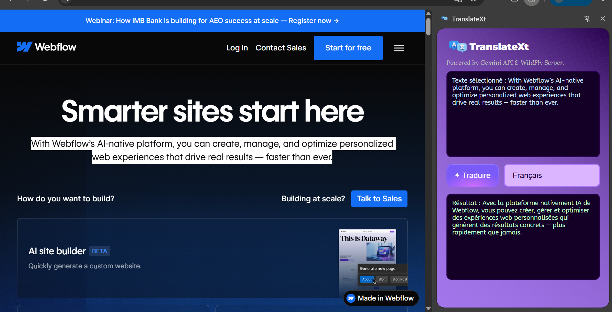

# Chrome Extension – Traduction intelligente avec Gemini AI

## Vidéo

## Description

Ce projet est une **extension Chrome intelligente** permettant de **traduire instantanément du texte sélectionné** sur n’importe quelle page web grâce à **Gemini AI (Google)**.

L’extension communique avec un **backend Java** qui interroge l’API Gemini et retourne une traduction fluide et contextuelle.

Objectif :

> Offrir une traduction rapide, fiable et contextuelle, sans quitter la page web.

## Fonctionnalités

* Traduction dans plusieurs langues
* Affichage immédiat du texte traduit
* Traduction basée sur **Gemini AI**
* Architecture **Extension Chrome + Backend Java**
* Appels API sécurisés côté serveur

## Technologies utilisées

### Backend

* Java 17+
* Maven
* API Gemini (Google Generative Language)
* Jackson (JSON)
* WildFly Server

### Frontend (Extension Chrome)

* JavaScript (ES6)
* Chrome Extensions Manifest V3
* HTML / CSS

## Utilisation

1. Sélectionner un texte sur une page web
2. L’extension détecte automatiquement la sélection
3. La traduction s’affiche instantanément
4. Choisir la langue cible si nécessaire

### Images 

## Sécurité

* La clé API Gemini est stockée **uniquement côté backend**
* Aucune clé exposée dans l’extension
* Communication sécurisée via HTTP POST

## Améliorations possibles

* Détection automatique de la langue source
* Support hors-ligne partiel
* Historique des traductions
* Mode sombre
* Publication sur Chrome Web Store
